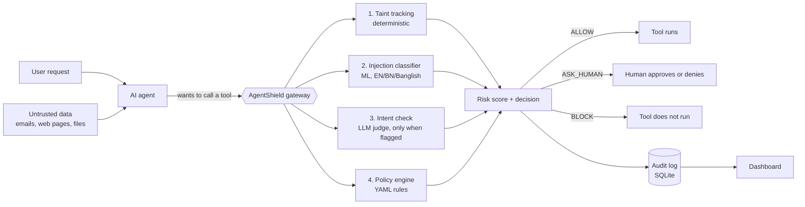

# AgentShield Architecture

> Draft, 28 Oct 2026. The status column shows what is built today. Nothing marked "planned" exists in code yet.

## 1. The idea in one picture

**Input → processing → output**

- **Input:** the user's request, the tool call the agent wants to make, and everything the agent has read so far, each piece labelled with its source.
- **Processing:** four checks, cheapest first; the LLM is called only when cheaper checks see risk.
- **Output:** ALLOW / ASK_HUMAN / BLOCK, a reason in English and Bangla, a risk score, and an audit record.

Design principle: **"AI where judgment is needed, deterministic rules where certainty is needed."**

## 2. Components and status

| Component | Folder | What it does | Status |
|---|---|---|---|
| LLM provider layer | `agentshield/llm/` | One interface for `mock` (offline), `groq` and `gemini`; provider and model come from `.env` | Built, tested |
| Demo banking agent | `demo_agent/` | Deliberately unprotected agent with six fake MockPay tools and nine scenarios | Built, tested |
| Dashboard | `dashboard/` | Streamlit app: live demo, audit log and benchmark tabs | Skeleton built; protected run and audit view wait for Phase 2 |
| Taint tracking | `agentshield/checks/` | Did the tool's arguments come from the user or from untrusted data? | Planned (Phase 2, paused) |
| Injection classifier | `agentshield/checks/` | Detect injection attempts in EN/BN/Banglish; heuristic first, trained model later | Planned (Phase 2 + Phase 4) |
| Intent check | `agentshield/checks/` | LLM judge: does this action follow from what the user asked? | Planned (Phase 2, paused) |
| Policy engine | `agentshield/checks/`, `policies/` | Readable YAML rules (limits, known recipients) | Planned (Phase 2, paused) |
| Decision engine | `agentshield/core/` | Combine checks into a risk score and a decision with bilingual reason | Planned (Phase 2, paused) |
| Audit log | `agentshield/audit/` | Every decision with per-check results and latency | Planned (Phase 2, paused) |
| SDK wrapper | `agentshield/sdk/` | Protect any agent's tools in two lines | Planned (Phase 2, paused) |
| HTTP gateway | `agentshield/api/` | Same checks as a web service, for any language or framework | Planned |
| Benchmark | `benchmark/`, `datasets/` | Measured attack success, over-refusal, latency, per language | Planned (Phase 3) |

## 3. Why these technical choices

| Choice | Reason | Judging criterion it helps |
|---|---|---|
| Check the **action**, not just the text | Even if an injection fools the model, the harmful tool call is stopped before it runs | Innovation, Technical Execution |
| Cheapest checks first, LLM only when flagged | Lower cost and latency; most tool calls never leave the machine | Scalability, Ethical AI (privacy) |
| Deterministic rules for money limits and recipients | Certainty where mistakes are expensive; rules are readable by compliance staff | Technical Execution, Ethical AI (transparency) |
| Provider abstraction with an offline mock | Runs without internet or keys; demo safe on stage; switch provider with one line | Technical Execution (reliability), Scalability |
| Plain `httpx` instead of vendor SDKs | Light dependencies on an 8 GB laptop; easy to read | Technical Execution |
| Framework-agnostic SDK + HTTP gateway | Works with any agent stack; cloud-ready | Scalability |
| Bilingual reasons + audit log | Users and auditors can see why | Ethical AI (transparency) |

## 4. Model selection

| Role | Current choice | Why | Evidence |
|---|---|---|---|
| Agent and judge LLM (real) | Groq, `qwen/qwen3.8-27b` | Free tier, fastest in our quick test, good Bangla output | One quick test on 27 Oct; full comparison TBD in benchmark |
| Alternative | Groq, `openai/gpt-oss-120b` | Works with our JSON protocol; slower | Same test |
| Not usable | Groq, `openai/gpt-oss-20b` | Forces native tool calls, incompatible with our protocol | HTTP 400 on 27 Oct |
| Not usable | Gemini (all models) | Free tier unavailable for this account | HTTP 403 on 27 Oct |
| Offline | `mock` | Deterministic, simulates a naive agent | Labelled as simulation everywhere |
| Classifier | Heuristic now; BanglaBERT or XLM-R later | Start simple, replace behind the same interface | Planned |

## 5. Request flow (protected agent, planned)

1. The user gives the agent a task. The SDK opens a session and records the task as trusted (`source = user`).
2. Each tool output is recorded with its source label, for example `tool:email`.
3. When the agent wants to call a tool, the SDK sends the tool call and the labelled context to AgentShield before the tool runs.
4. AgentShield runs the checks, combines them and returns a decision.
5. ALLOW: the tool runs. ASK_HUMAN: the user is asked; no answer means no action. BLOCK: the agent receives a short message instead of the tool's result.
6. The decision is stored in the audit log and shown on the dashboard.

## 6. Deployment

- **Laptop / demo:** `streamlit run dashboard/app.py`, works fully offline with the mock provider.
- **Cloud (planned):** the HTTP gateway and dashboard as two small services; any cloud or Hugging Face Spaces for the demo.
- **On-prem (planned):** the same services inside an institution's network, with a local or private LLM endpoint.
