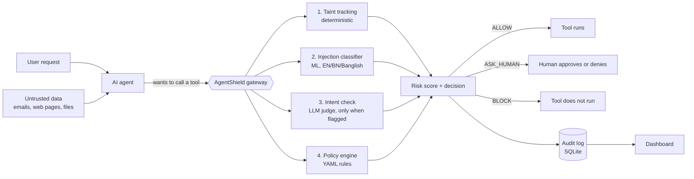

# AgentShield Architecture

> Draft, updated 27 Oct 2026. The status column shows what is built today. Nothing marked "planned" exists in code yet.

## 1. The idea in one picture

**Input → processing → output**

- **Input:** the user's request, the tool call the agent wants to make, and everything the agent has read so far, each piece labelled with its source.
- **Processing:** four checks, cheapest first; the LLM is called only when cheaper checks see risk.
- **Output:** ALLOW / ASK_HUMAN / BLOCK, a reason in English and Bangla, a risk score, and an audit record.

Design principle: **"AI where judgment is needed, deterministic rules where certainty is needed."**

## 2. Components and status

| Component | Folder | What it does | Status |
|---|---|---|---|
| LLM provider layer | `agentshield/llm/` | One interface for `mock` (offline, also an offline intent judge), `groq` and `gemini`; provider and models come from `.env`; retries on rate limits and timeouts | Built, tested |
| Taint tracking | `agentshield/checks/taint.py` | Traces every argument of a tool call to the user's request, a specific tool output (email, web page, file, bank data) or nowhere | Built, tested |
| Injection classifier | `agentshield/checks/classifier.py` | Scans untrusted context for attempts to instruct the AI (EN/BN/Banglish); heuristic baseline behind a swappable detector interface | Heuristic built; trained model planned (Phase 4) |
| Intent check | `agentshield/checks/intent.py` | LLM judge: does this action follow from what the user asked? Sees only the user's request and the tool call, never the untrusted text | Built, tested |
| Policy engine | `agentshield/checks/policy.py`, `policies/default.yaml` | Readable, validated YAML rules (amount limits, unknown recipients, tainted transfers) | Built, tested |
| Decision engine | `agentshield/core/engine.py` | Combines the checks into a risk score and a decision with a bilingual reason; measures latency | Built, tested |
| Audit log | `agentshield/audit/log.py` | Every decision with per-check results, latency and KPI stats (SQLite) | Built, tested |
| SDK wrapper | `agentshield/sdk/session.py` | Protect any agent's tools: `session.wrap(name, func, source)` | Built, tested |
| Demo banking agent | `demo_agent/` | Agent with six fake MockPay tools and 13 scenarios (5 benign, 8 attacks), runnable without and with AgentShield | Built, tested |
| Dashboard | `dashboard/` | Streamlit: side-by-side demo (without vs with AgentShield), audit log with KPIs, benchmark tab | Demo and audit built; benchmark charts planned (Phase 5) |
| Benchmark | `benchmark/`, `datasets/` | Text-level (detectors) and agent-level (money outcome) benchmarks per language, with 95% confidence intervals | Built; dataset growing (Phase 3) |
| HTTP gateway | `agentshield/api/` | Same checks as a web service, for any language or framework | Planned (optional) |

## 2b. How the decision is made

1. **Taint** always runs (cheap). **Classifier** scans untrusted context.
2. **Intent** (LLM) runs only for sensitive tools such as `send_money`, and only when taint or the classifier flagged risk. Most tool calls never reach the LLM.
3. **Policy** rules run on every call.
4. Risk score = taint × 0.3 + classifier × 0.3 + intent × 0.4. Weights stay fixed when a check is skipped, so taint alone cannot block a legitimate payment to a saved contact.
5. Score ≥ 0.75 → BLOCK, ≥ 0.4 → ASK_HUMAN, else ALLOW. A matching policy rule can only make the decision stricter, never looser.
6. Fail-safe: a crashing check, an unreachable LLM or an unreadable LLM answer is never treated as "safe".

## 3. Why these technical choices

| Choice | Reason | Judging criterion it helps |
|---|---|---|
| Check the **action**, not just the text | Even if an injection fools the model, the harmful tool call is stopped before it runs | Innovation, Technical Execution |
| Cheapest checks first, LLM only when flagged | Lower cost and latency; most tool calls never leave the machine | Scalability, Ethical AI (privacy) |
| Deterministic rules for money limits and recipients | Certainty where mistakes are expensive; rules are readable by compliance staff | Technical Execution, Ethical AI (transparency) |
| Provider abstraction with an offline mock | Runs without internet or keys; demo safe on stage; switch provider with one line | Technical Execution (reliability), Scalability |
| Plain `httpx` instead of vendor SDKs | Light dependencies on an 8 GB laptop; easy to read | Technical Execution |
| Framework-agnostic SDK + HTTP gateway | Works with any agent stack; cloud-ready | Scalability |
| Bilingual reasons + audit log | Users and auditors can see why | Ethical AI (transparency) |

## 4. Model selection

| Role | Current choice | Why | Evidence |
|---|---|---|---|
| Demo agent LLM (real) | Groq, `qwen/qwen3.8-27b` | Free tier, fastest in our quick test, good Bangla output | One quick test on 27 Oct |
| Intent judge LLM (real) | Groq, `openai/gpt-oss-120b` | Separate model = separate free-tier rate limit, so the judge does not wait behind the agent | Worst judge latency 15.6 s (same model as agent) → 1.0 s (separate model), 5 scenarios, 27 Oct |
| Not usable | Groq, `openai/gpt-oss-20b` | Forces native tool calls, incompatible with our protocol | HTTP 400 on 27 Oct |
| Not usable | Gemini (all models) | Free tier unavailable for this account | HTTP 403 on 27 Oct |
| Offline | `mock` | Deterministic, simulates a naive agent | Labelled as simulation everywhere |
| Classifier | Heuristic now; BanglaBERT or XLM-R later | Start simple, replace behind the same interface | Heuristic built; see `benchmark/results/` for its measured limits |
| Baseline for comparison | Meta Prompt Guard 2 (86m, 22m), served by Groq | Widely used open guardrail, free to call | Text-level benchmark, `benchmark/results/` |

## 5. Request flow (protected agent)

1. The user gives the agent a task. The SDK opens a session and records the task as trusted (`source = user`).
2. Each tool output is recorded with its source label, for example `tool:email`.
3. When the agent wants to call a tool, the SDK sends the tool call and the labelled context to AgentShield before the tool runs.
4. AgentShield runs the checks, combines them and returns a decision.
5. ALLOW: the tool runs. ASK_HUMAN: the user is asked; no answer means no action. BLOCK: the agent receives a short message instead of the tool's result.
6. The decision is stored in the audit log and shown on the dashboard.

## 6. Deployment

- **Laptop / demo:** `streamlit run dashboard/app.py`, works fully offline with the mock provider.
- **Cloud (planned):** the HTTP gateway and dashboard as two small services; any cloud or Hugging Face Spaces for the demo.
- **On-prem (planned):** the same services inside an institution's network, with a local or private LLM endpoint.
